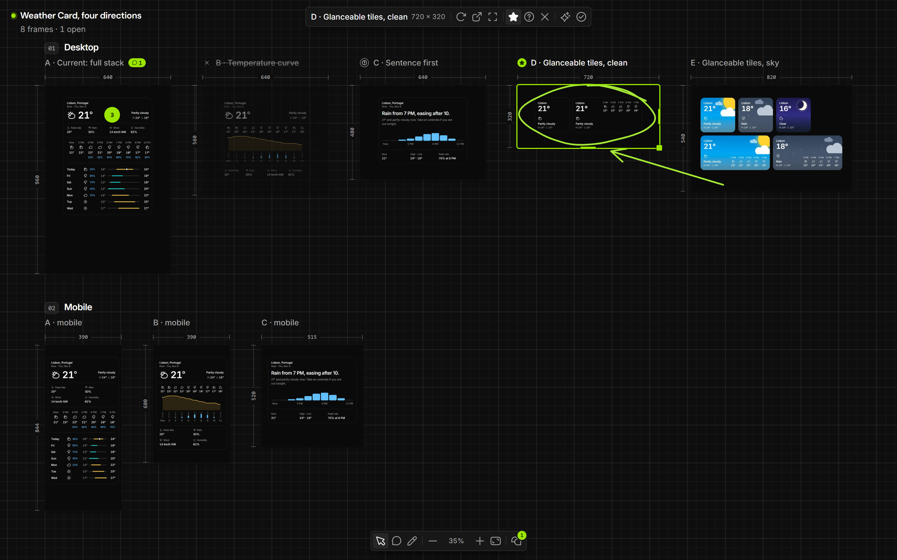
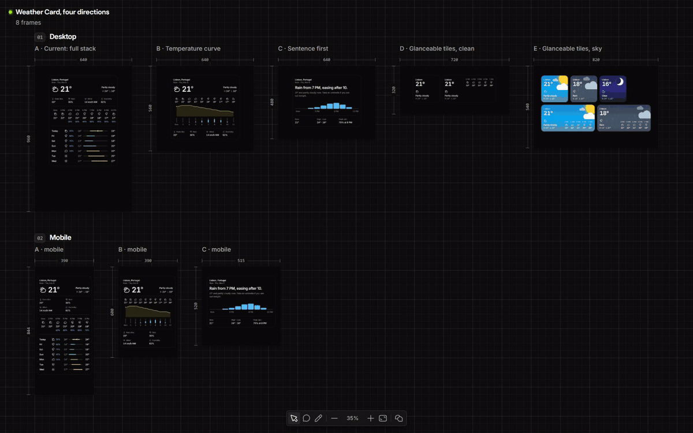
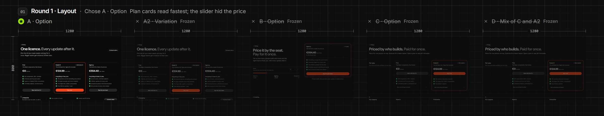

<p align="center">
  <picture>
    <source media="(prefers-color-scheme: light)" srcset="docs/media/canvas-light.png">
    
  </picture>
</p>

<h1 align="center">Koala POC Canvas</h1>

<p align="center">
  Agents lay out live variants of your screens. You decide.<br>
  <a href="https://www.jordiespinosa.com/projects/koala-poc-canvas"><b>Documentation</b></a> ·
  <a href="#install">Install</a> ·
  <a href="#the-loop">The loop</a> ·
  <a href="#commands">Commands</a> ·
  <a href="#faq">FAQ</a>
</p>

---

I used to weigh design options in Figma: three directions side by side, a few notes, then a choice. With agents writing the code, the options are already real. They just live in three branches, or three tabs, and nobody remembers why one won.

Koala POC Canvas puts them back on one surface. It's a local canvas where every frame is a **live route of your own dev server**. Agents build three or four directions of a screen and lay them out in rows. You mark them **Pick**, **Maybe** or **Out**, pin comments, draw on them, ask for more or a mix, and choose. The decision is recorded and the losing options freeze into images, so the history survives when their code is deleted.

It runs on your machine. Nothing goes to any cloud.

## Install

```bash
npm i -g https://github.com/jespinosa19/koala-poc-canvas/releases/latest/download/koala-poc-canvas.tgz
koala-poc-canvas skill
```

The first line installs the CLI (Node 20+). The second installs the agent skill and its three agents in `~/.claude`, so Claude Code knows the tool in every project.

Then open a project that has a dev server and ask for something small:

```
Put three directions of the pricing card on the canvas.
```

The agent starts the canvas, builds the variants as scratch routes, checks each one renders and hands you a URL: `http://localhost:4848/__canvas/`. It won't always nail it in one round. That's what the next round is for.

## The loop

<p align="center"></p>

A round answers one question. Layout first, then visual.

| Step | Who | What happens |
| --- | --- | --- |
| **Variants** | agents | 3–4 genuinely different directions, one route each, laid out in a row named for the question (`Round 1 · Layout`). |
| **Verdicts** | you | **P** Pick, **M** Maybe, **X** Out. Out frames dim and strike through. Every verdict is signal for the next round. |
| **Feedback** | you | **C** pins a comment on a point or a dragged area. **D** draws: pen, marker, arrow, box, circle. The agent reads the element under each one. |
| **Requests** | you | *More like this* on a frame, *Mix* across two or more, *Choose this* to decide. |
| **Decision** | agent | `decide` records the winner and the reason in your words. The other frames freeze into images. |

<p align="center"></p>

Frames reference routes, never copies. Edit the route and the frame hot-reloads.

## The team

One context can't read the history, build four routes and judge them honestly. So a round is split across three agents, installed by `koala-poc-canvas skill`:

- **`koala-poc-canvas-researcher`** reads the screen, the design system and the canvas history (verdicts, decisions, comments, drawings, requests). It writes a brief: Keep, Avoid, your signals, and 3–4 directions with one file each. Read-only.
- **`koala-poc-canvas-builder`** builds exactly one direction. One per direction, all in parallel, never sharing a file. Each self-checks with `koala-poc-canvas check`.
- **`koala-poc-canvas-reviewer`** renders every variant, judges it against the brief and checks the set is really different. Pass or fix, per variant.

The lead agent talks to you and owns the canvas. Only variants that passed review get added. Your time is the scarce resource.

Small jobs skip the team: a single variation, or a one-line fix after a comment.

## Commands

Every command prints JSON, so agents can read it. Run them from the project root.

**Canvas**

| Command | Does |
| --- | --- |
| `serve --target http://localhost:5173` | Runs the canvas for this folder on `:4848` and proxies every other path to your dev server (HTTP and websockets), so frames are same-origin and keep hot reload. `--port`, `--host`. |
| `init [name] --title T` | Creates a canvas and makes it current. |
| `use <name>` | Switches to another canvas. |
| `open` | Prints the canvas URL. |
| `skill [--project]` | Installs the skill and agents in `~/.claude` (or this project's `.claude`). |

**Frames**

| Command | Does |
| --- | --- |
| `add --route /lab/x?v=b --title T` | Adds a live frame. Also `--url` or `--image`. `--device desktop\|laptop\|tablet\|mobile` or `--width --height`, `--row`, `--note`, `--from F` (a variation of F, placed right after it). |
| `update <frame> […]` · `remove <frame>` | Changes or removes a frame. |
| `list [--all]` | Frames of the current canvas, with verdicts and open feedback. |
| `check --route /lab/x` | Renders a route **without adding it**: status, console errors and a screenshot. The reviewer's main tool. |
| `screenshot <frame> [--pins]` | A PNG of the frame. `--pins` draws open comments and drawings on it. |

**Feedback**

| Command | Does |
| --- | --- |
| `context` | What you have selected or focused right now. "This one" means this. |
| `comments [--all] [--frame F]` | Open comments, with the element under each pin (`selector` and text). |
| `comments reply <id> "text"` · `resolve <id> --note N` · `reopen <id>` | Answers, closes or reopens a comment. |
| `drawings [--frame F] [--points]` | What you drew: tool, colour, bounds, the element under it (for an arrow, under its head), nearby comments and a plain description. |
| `drawings remove <id…>` · `drawings clear` | Takes drawings off once acted on. |
| `requests [--all]` | What you asked for: `more`, `mix`, `decide`. |
| `requests done <id> --frames a,b` · `requests cancel <id>` | Closes a request. |

**Decisions**

| Command | Does |
| --- | --- |
| `verdict <frame> pick\|maybe\|out\|none` | Marks a frame (you usually do this on the canvas). |
| `decide <row\|frame> --why "…" [--winner F] [--keep]` | Records the decision and freezes the other frames into images. `--keep` leaves them live. |
| `decisions` | Every decision on this canvas. |
| `thaw <frame>` | A frozen frame goes live again. |

`--canvas <name>` (or `-c`) targets a canvas other than the current one. The old command name, `koala-canvas`, still works.

## Shortcuts

| Key | Does |
| --- | --- |
| **V** · **C** · **D** | Move · Comment · Draw |
| **1**–**5** · **E** | In Draw: pen, marker, arrow, box, circle · eraser |
| **P** · **M** · **X** | Pick · Maybe · Out on the selection |
| **F** or double-click | Focus a frame (it becomes interactive). **Esc** goes back, **←/→** step. |
| **⇧1** | Fit everything |
| **Ctrl/⌘ Z** | Undo the last drawing |
| Wheel · Ctrl/⌘ + wheel or pinch · Space + drag | Pan · zoom · pan |
| **Shift**-click | Add frames to the selection (then *Mix*) |

The keys work even while a focused frame's page has the keyboard.

## FAQ

**Does it work with my stack?**
Any web project with a dev server: Vite, Next.js, Remix, Astro, plain HTML. The canvas proxies your routes, so there is nothing to install in the project itself.

**Do I need Claude Code?**
No. The CLI works on its own and any agent that can run shell commands can drive it. The skill and the three agents are written for Claude Code.

**Where does the state live?**
In `.koala-canvas/` at the project root: one JSON file per canvas, plus frozen images. Add it to `.gitignore`. Never edit the JSON by hand; the CLI writes atomically and the page updates live.

**Where do the variants live?**
In a scratch area of your project that doesn't ship (`/playground`, `/lab`, `/dev`). When you decide, fold the winner into the real code and delete the rest. The decision keeps their pictures.

**My screen only runs inside a host app.**
A FiveM NUI or an Electron renderer needs a route that renders it in a plain browser with mock data. Then it works like any other route.

**Can I use it on a remote machine?**
Yes. Install it there, run `serve`, and forward one port: `ssh -L 4848:localhost:4848 <host>`. The dev server is reached through the canvas proxy. `check`, `screenshot` and `decide` need Chrome or Chromium on that machine (`CHROME_PATH` if it isn't on the PATH).

**Why "POC"?**
Because every frame is a proof of concept: real code, running, that you can click. Not a mockup.

## Limitations

- It's local and single-user. There are no shared cursors or accounts.
- Screenshots and frozen frames need Chrome or Chromium.
- The agents are only as good as the brief. Vague rounds get similar variants; the reviewer catches some of it, not all.
- It's opinionated: rounds, rows, one question at a time. That's the point, but it won't suit every way of working.

## Develop

```bash
git clone https://github.com/jespinosa19/koala-poc-canvas.git
cd koala-poc-canvas
npm install      # also builds dist/
npm link         # puts koala-poc-canvas (and koala-canvas) on the PATH, pointing here
koala-poc-canvas skill
```

After a change in `src/`, `npm run build` reaches every project. `npm run typecheck` checks types.

- `src/client/`: the canvas UI (React). `canvas-ink.tsx` is the Draw tool; `canvas-toolbar.tsx` the floating bars.
- `src/store.ts`: the `.koala-canvas/<canvas>.json` state. Fields added later are optional, so old canvases keep loading.
- `src/ops-core.ts` · `src/ops.ts`: the operations the page sends.
- `src/server.ts`: serves the UI at `/__canvas/`, its API at `/__canvas/api`, and proxies everything else to `--target`.
- `src/cli.mjs` · `src/bin.mjs`: the CLI.
- `skill/`: the agent skill and its three agents.
- `koala/`: the [Koala UI](https://github.com/jespinosa19/koala-ui) Free pieces the canvas is built with (tactile concept, Lime accent), MIT. `npm run sync-koala -- <Koala UI checkout>` refreshes them.
- `ui/demo.html`: the real canvas UI with no server, answering its own API in the browser. `node build-demo.mjs <out dir>` builds it for a website.

### Release

1. Bump `version` in `package.json`, then `npm run pack:tgz`.
2. `cp dist-pack/koala-poc-canvas-<version>.tgz koala-poc-canvas.tgz` and `gh release create v<version> koala-poc-canvas.tgz`. The asset keeps a fixed name, so the `latest/download` URL never changes.

## License

[MIT](LICENSE) © Jordi Espinosa. The files in `koala/` are Koala UI Free, also MIT ([koala/LICENSE](koala/LICENSE)).
